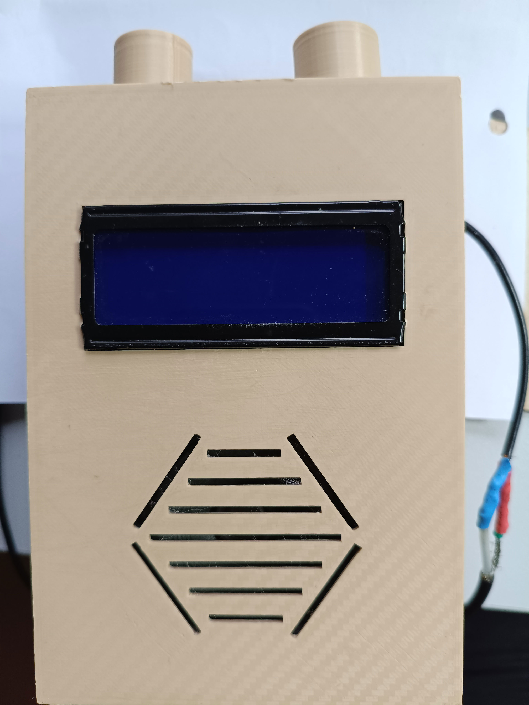
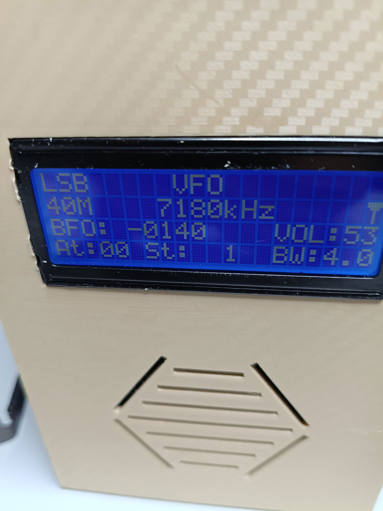
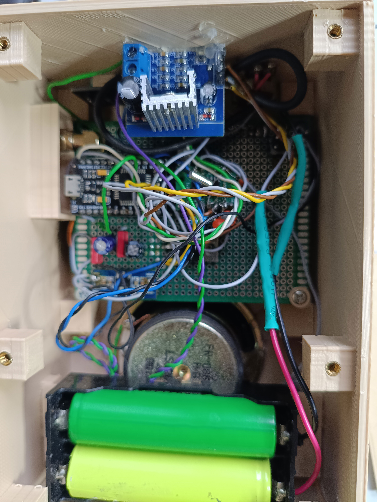
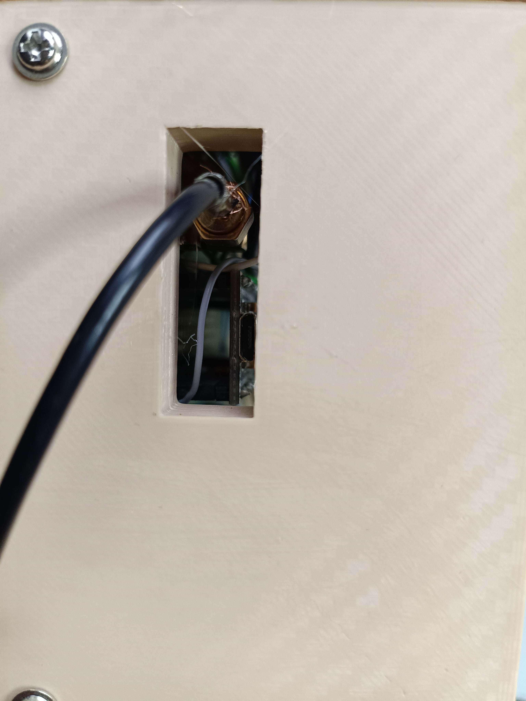

# Allwellenreceiver (SI4735 + Arduino Micro + LCD 20x4)

Ein kompakter, leistungsfähiger DIY-Allwellenempfänger für **UKW (FM), Mittelwelle (MW), Kurzwelle (SW) und Langwelle (LW)** inklusive **SSB (USB/LSB)** und **CW**, aufgebaut mit einem **Arduino Micro (ATmega32U4)**, dem **Silicon Labs SI4735 / SI4732** Radio-IC und einem klassischen **20x4 LCD-Display**, untergebracht in einem maßgeschneiderten **3D-Druckgehäuse**.

Das Projekt basiert auf Konzepten der SI4735-Amateurfunk-Community (u. a. [IU4ALH](https://github.com/IU4ALH/IU4ALH) und der SI4735-Bibliothek von [PU2CLR](https://github.com/pu2clr/SI4735)), wurde jedoch speziell für den kompakten **Arduino Micro**, ein 4-Bit paralleles **20x4 LCD** und optimierte Firmware mit EEPROM-Speicherung, schnellem Menü und BFO-Feinabstimmung angepasst.

---

## Impressionen & Gehäuse (3D-Druck)

  
  

  
  

Die druckfertige 3D-Modelldatei (STL) für das Gehäuse befindet sich im Ordner [`enclosure/`](enclosure/):
* **3D-Druckdatei:** [`enclosure/radio_enclosure.stl`](enclosure/radio_enclosure.stl)

> **Hinweis zum Gehäuse:** Das Gehäuse ist ein funktionierender DIY-Prototyp (Handarbeit, nicht KI-generiert) und bietet eine solide Basis für den Alltagsbetrieb. Anpassungen und Weiterentwicklungen sind ausdrücklich erwünscht!

---

## Features

- **Empfangsbereiche:**
  - **UKW (FM):** 87.0 MHz – 108.0 MHz (mit 50 µs De-Emphasis, Stereo-Blend & optimierten Soft-Mute-Schwellen)
  - **Langwelle (LW):** ab 150 kHz
  - **Mittelwelle (MW):** MW1, MW2, MW3 (bis 3500 kHz)
  - **Kurzwelle (SW):** Durchgehende Bandsegmente SW1 bis SW9, sowie durchgehender Bereich (ALL 150 kHz – 30 MHz)
  - **Amateurfunkbänder:** 80m (LSB), 40m (LSB), 20m (USB), 15m (USB), 10m (USB)
  - **CB-Funk:** 11m (AM)
- **Modulationsarten:** AM, LSB, USB, CW
- **SSB Patch-Support:** Lädt das SI4735 SSB-Patch für echten Einseitenband- und Morsesignal-Empfang.
- **BFO-Feinabstimmung:** Schnelle und präzise BFO-Einstellung (25-Hz-Schritte) zur perfekten Demodulation von SSB/CW.
- **Bandbreitenfilter:** Umschaltbare Filterbandbreiten für AM und SSB zur Unterdrückung von Nachbarkanalstörungen.
- **Automatische / Manuelle Verstärkungsregelung (AGC & Attenuation):** Startet mit maximaler Empfindlichkeit, manuell regelbar.
- **EEPROM-Speicher:**
  - Letzte Frequenz, Betriebsart, Schrittweite und Bandbreite werden pro Band automatisch im EEPROM gespeichert und beim Einschalten wiederhergestellt.
- **Benutzeroberfläche:**
  - 20x4 Zeichen LCD mit Signalstärkeanzeige (S-Meter / RSSI).
  - Drehimpulsgeber (Rotary Encoder) mit integriertem Taster für Frequenzabstimmung und Menünavigation.
  - Individueller Startbildschirm (Fuchs-Grafik).
- **Portabler Akkubetrieb & Schalter:**
  - Versorgung über **2x 18650 Li-Ion Akkus in Reihe (7.4V – 8.4V)**.
  - Hauptschalter integriert im **Lautstärkepotentiometer** (klassisches Einschalten beim Aufdrehen der Lautstärke).
  - Zweistufige Spannungsarchitektur: **Step-Down Wandler auf 3.3V** (für Arduino & SI4735) und ein **LM7805 Spannungsregler-IC auf 5V** (für LCD und Logik).

---

## Bedienung & Steuerung

Die gesamte Abstimmung und Menüsteuerung erfolgt über den Drehimpulsgeber (Rotary Encoder) und dessen integrierten Taster. Das Ein- und Ausschalten erfolgt klassisch über das Lautstärkepotentiometer:

| Aktion | Funktion |
| :--- | :--- |
| **Lautstärkepoti drehen / klicken** | **Ein-/Ausschalter & analoge Lautstärke:** Schaltet das Radio beim Aufdrehen ein und regelt stufenlos den TDA2030-Verstärker. |
| **Drehen (Normalbetrieb)** | **VFO-Frequenzabstimmung:** Erhöht oder verringert die Empfangsfrequenz entsprechend der gewählten Schrittweite. |
| **1x Klick (kurz)** | **Bandwechsel (Band):** Drehen schaltet zwischen den Bändern (UKW, MW1-3, 80m, SW1-9, 40m, 20m, 15m, CB, 10m, ALL) um. |
| **Doppelklick** | **Menü öffnen (Menu):** Drehen blättert durch die Parameter (*Volume, Step, Mode, BFO, AGC, Bandwidth, SoftMute*). Klick wählt den Parameter aus. |
| **BFO aktiv (SSB/CW)** | **BFO-Feinabstimmung:** Drehen verstellt den BFO in feinen 25-Hz-Schritten zur Schwebungs- und Tonhöhenabstimmung. |
| **Gedrückt halten beim Einschalten** | **EEPROM-Reset:** Setzt alle gespeicherten Frequenzen und Einstellungen auf Standardwerte zurück (`EEPROM RESETED`). |

---

## Hardware & Stromversorgung

### Komponenten & Stromversorgungs-Architektur
1. **Mikrocontroller:** Arduino Micro (ATmega32U4)
2. **Empfänger-Modul:** Silicon Labs **SI4732** (auf **Pfostenstecker / Buchsenleiste** gesteckt – dadurch modular und bei Bedarf tauschbar)
3. **Display:** HD44780-kompatibles LCD-Modul 20x4 im 4-Bit-Parallelbetrieb (ebenfalls über **Pfostenstecker** steckbar montiert für einfachen Einbau und Service)
4. **Bedienung:** Rotary Encoder mit Push-Button
5. **Ein-/Ausschalter & Audiopegel:** Lautstärkepotentiometer mit integriertem Netzschalter (beim Rechtsdrehen klickt der Schalter ein und schaltet die Akkuspannung zu).
6. **NF-Verstärker:** TDA2030 Audio-Verstärkermodul, versorgt direkt aus der 2S-Akkuspannung für dynamische und verzerrungsfreie Lautsprecherwiedergabe.
7. **Spannungsversorgung (2S Li-Ion):**
   - **Akkus:** 2x 18650 Li-Ion Zellen in Reihe (7.4V Nennspannung, bis 8.4V Ladeschlussspannung).
   - **Step-Down (Buck) Wandler:** Regelt effizient auf 3.3V für den Arduino und das SI4732-Modul.
   - **Spannungsregler LM7805:** Liefert brummfreie, saubere 5V für die Hintergrundbeleuchtung und Logik des 20x4 LCDs.
8. **Gehäuse:** 3D-Druckgehäuse ([`enclosure/radio_enclosure.stl`](enclosure/radio_enclosure.stl))

### Pinout (Arduino Micro)

| Funktion / Komponente | Arduino Micro Pin | Bemerkung |
| :--- | :--- | :--- |
| **Rotary Encoder Pin A** | Pin 0 (RX) | Interrupt-fähig |
| **Rotary Encoder Pin B** | Pin 1 (TX) | Interrupt-fähig |
| **Rotary Push Button** | Pin 15 | Menüauswahl / Bestätigung |
| **SI4735 RESET** | Pin 10 | Hardware-Reset für Radio-IC |
| **SI4735 SDA** | Pin 2 | I2C Datenleitung |
| **SI4735 SCL** | Pin 3 | I2C Taktleitung |
| **LCD RS** | Pin 14 (MISO) | Register Select |
| **LCD Enable (E)** | Pin 16 (MOSI) | Enable |
| **LCD D4** | Pin 4 | Datenleitung Bit 4 |
| **LCD D5** | Pin 5 | Datenleitung Bit 5 |
| **LCD D6** | Pin 6 | Datenleitung Bit 6 |
| **LCD D7** | Pin 7 | Datenleitung Bit 7 |

---

## Installation & Kompilierung

1. **Arduino IDE vorbereiten:**
   - Installiere die aktuelle Arduino IDE.
   - Wähle als Board: **Arduino Micro** (bzw. Arduino Leonardo).
2. **Benötigte Bibliotheken:**
   - [PU2CLR SI4735](https://github.com/pu2clr/SI4735) (über den Arduino Bibliotheksverwalter installierbar)
   - `LiquidCrystal` (in Arduino integriert)
   - `EEPROM` (in Arduino AVR Core integriert)
3. **Sketch öffnen & hochladen:**
   - Öffne die Datei [`radio/radio.ino`](radio/radio.ino) in der Arduino IDE.
   - Verbinde den Arduino Micro per USB und lade den Sketch hoch.

---

## Danksagung & Credits

- Besonderer Dank an **Ricardo Caratti (PU2CLR)** für die herausragende [SI4735 Arduino Library](https://github.com/pu2clr/SI4735).
- Dank an **IU4ALH** für seine Schaltungsbeispiele und Inspirationen rund um SI4735-Projekte.

---

## Lizenz

Dieses Projekt steht unter der [MIT License](LICENSE).
3D-Druck- und Gehäusedateien stehen unter [CC BY-SA 4.0](https://creativecommons.org/licenses/by-sa/4.0/).
